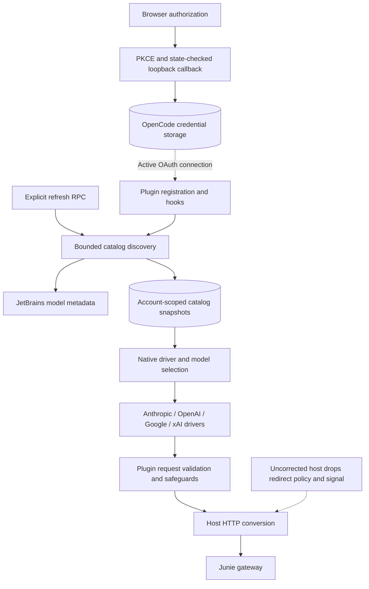
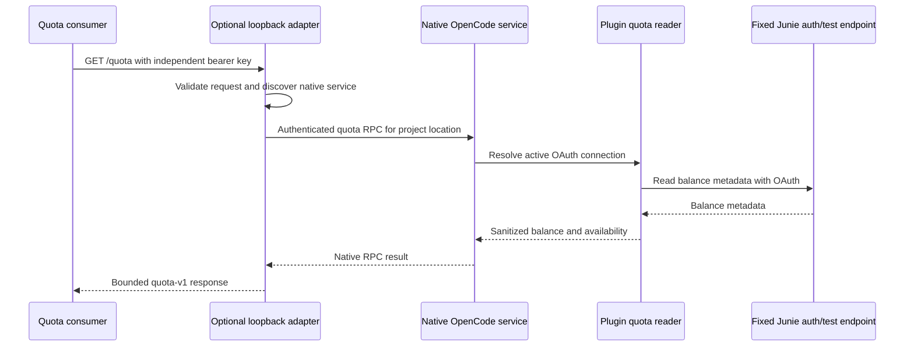

# Architecture

The plugin registers provider `jetbrains` and integration `jetbrains-junie-oauth` through OpenCode's native plugin API. `src/index.ts` owns registration, validated options, scoped hooks, and cleanup. It does not own an OAuth token database, inference driver, or external quota daemon. An opt-in quota listener runs inside the plugin process.

## Authentication and inference

The inference path above illustrates the transport boundary, not approval to run inference on an uncorrected host.

`src/oauth.ts` implements PKCE with a state-checked loopback callback, bounded token exchange, cancellation, and in-process single-flight refresh. OpenCode owns credential persistence and cross-process refresh coordination. Junie CLI credentials are never imported.

`src/inventory.ts` selects native Anthropic, OpenAI Responses, Google, or xAI drivers and their effort settings. Those drivers handle SSE, reasoning, tools, and usage; the plugin does not translate streams. Advertised input/output support is text only.

`src/transport.ts` validates the gateway, method, route, and configured model before rebuilding authentication headers. It restricts Anthropic fields, disables redirects, combines cancellation with a deadline, and sanitizes unsuccessful HTTP responses. Errors inside successful streams remain the native driver's responsibility. Provider hooks disable automatic retries; there is no account, license, or endpoint fallback.

**Host boundary:** OpenCode 2.2.5 does not preserve the hook's redirect policy and signal through its HTTP conversion. The [prepared host correction](docs/host-transport-blocker.md) is not installed by this plugin. Plugin tests do not prove that the installed host is safe for inference.

## Catalog and storage

1. Explicit `jetbrains-junie/refresh` RPC resolves the active OAuth connection and fetches fixed-origin, bounded metadata through `src/catalog.ts`.
2. `src/inventory.ts` reconciles listings with `src/static-catalog.ts`, the embedded Junie 3959.5 inventory. Exact IDs take precedence; dated aliases must be unambiguous. Unlisted models are omitted, not guessed.
3. `src/discovery.ts` validates and stores sanitized snapshots in native plugin-namespaced storage, scoped to connection, routing, schema, and metadata source. Account changes invalidate the published inventory; checks before and after asynchronous work prevent cross-account publication.
4. Other locations restore the same account's snapshot. Events and a 15-second local-storage check synchronize it without startup HTTP requests. After 24 hours, status reports stale metadata; it does not refresh automatically.

RPCs `status` and `catalog` expose cache state and provenance. Listed limits override embedded limits; unknown output limits remain null in catalog metadata. Listings do not establish inference entitlement, and account prices are unknown. See [catalog provenance](docs/catalog-provenance.md).

## Balance and optional panel

`src/quota.ts` reads only the fixed Junie `/auth/test` endpoint using the active OAuth connection. It projects balance metadata, never identity fields. Credit units divide by 100,000; USD is unscaled. Unsupported or missing values remain unavailable. No allocation, percentage, spending, or reset date is inferred.

The legacy external-adapter panel path is:

`src/quota-bridge.ts` accepts authenticated `GET /quota` on `127.0.0.1` and emits only `quota-v1` balance/status data. Method, path, Host, Origin, body, and independent Bearer-key checks precede balance retrieval. Requests, connections, bodies, and shutdown are bounded. Shared mode adds an authenticated, provider/port/direction-bound nonce health exchange that never reads upstream balance metadata or sends the bearer to an unknown listener.

`src/quota-adapter.ts` discovers the native service on every authenticated request and invokes only the quota RPC for an explicit project location. It does not cache balances or receive JetBrains OAuth tokens. Service credentials are restricted to loopback RPC dispatch. `src/cancellation.ts` shares prompt abort rejection for operations that ignore cancellation, without replacing each caller's resource cleanup.

Without `quotaBridge.autoKey: true`, the legacy option still describes an externally managed adapter (`management: "external", running: null`), preserving standalone deployments. Linux wrapper services remain transient and are not reboot-persistent.

With `autoKey: true`, `src/quota-bridge-plugin.ts` acquires a scope-owned lease and calls `discovery.balance` directly, forwarding request cancellation into `Effect.runPromise`. A process-global serialized registry prevents competing binds and retains the listener until the final location releases its lease. Status reports listener availability, not upstream health. Setup only resolves the active connection identity locally; it never resolves OAuth tokens or queries upstream.

`shared: true` additionally uses `src/quota-bridge-storage.ts` to publish one private Junie-only root key outside participating workspaces (`0700` directory, `0600` regular single-link key). State rejects unsafe ancestry, symlinks, broad permissions, malformed/oversized data, and unexplained hardlinks. Only a matching private staging inode permits recovery of an interrupted atomic key publication. No legacy adapter key is read or migrated. A transport bearer is HMAC-derived from this root key, the Junie protocol, port, and active connection identity; accounts do not share a transport bearer. The OAuth token is never an input.

`src/quota-bridge-shared.ts` authenticates an existing owner or binds the fixed loopback port, then performs bounded background health checks and follower takeover after owner exit. Concurrent processes share the same root key without an external service. Local leases must have the same connection identity; conflicting leases revoke a process-owned consumer key and fail closed. Balance reads recheck every local lease before and after retrieval. Shared followers recheck their own connection identity during monitoring and revoke their environment key on a change; this local synchronization is periodic, not an atomic cross-host account-change transaction. Account changes require closing the old managed leases and reloading the location before reactivation. See [quota operations and validation](docs/quota.md).

## Verification boundary

`test/` covers OAuth, catalog reconciliation and cache isolation, native driver behavior, request restrictions, quota parsing, and the loopback adapter. `scripts/quota-adapter.test.mjs` checks wrapper behavior with fake processes and files. Tests use fake credentials and local listeners, not real JetBrains inference. Check commands and contribution requirements are in [CONTRIBUTING.md](CONTRIBUTING.md).
